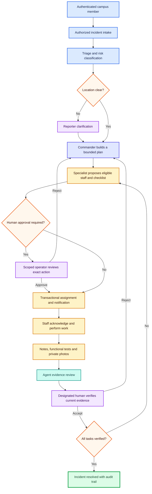
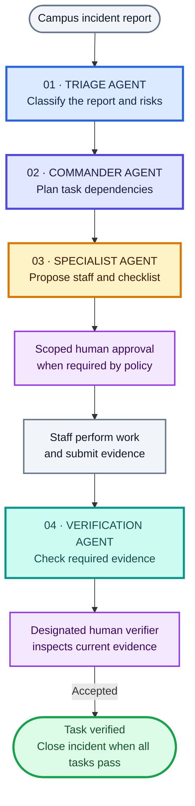
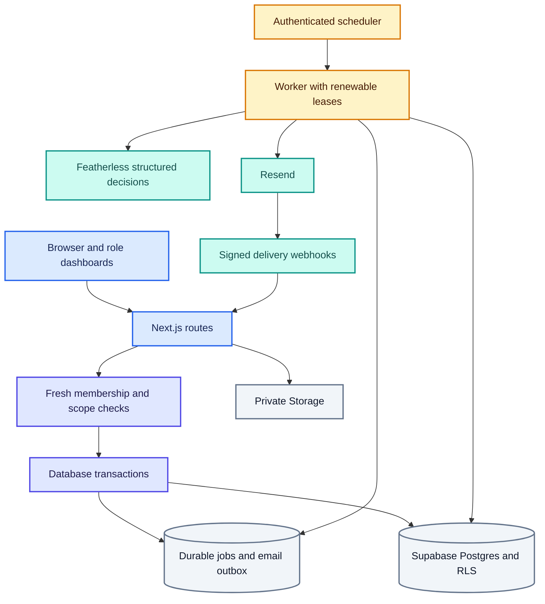
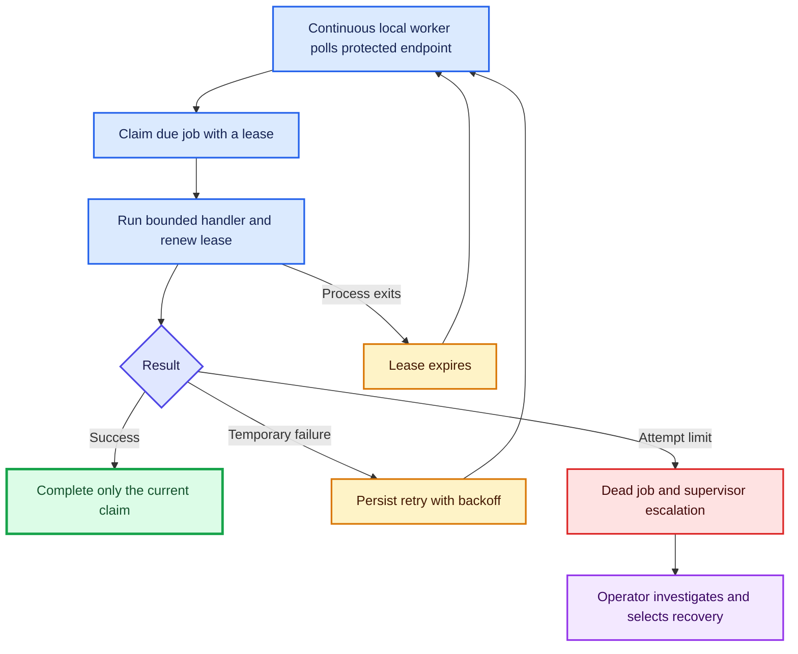

# ORION

**Operating Response & Incident Orchestration Network** — accountable campus incident handling with bounded AI planning and human authorization.

[Four agents](#the-four-agents) · [Start locally](#run-locally) · [Architecture](#how-it-fits-together) · [Repository map](#repository-map) · [Verification](#verify-a-change) · [Deployment](docs/operations/deployment.md)

The selected setup stays on Supabase Free and uses the existing local worker, with no paid scheduler configured. See the [free-plan operating guide](docs/operations/free-plan.md) for setup requirements and limits.

> **Release status:** the readiness migration is applied to the ORION Supabase project. Deploy the matching application/worker code and complete the [release checklist](docs/operations/readiness.md). See the [hosted migration record](docs/operations/hosted-migration-2026-10-22.md) for verification and remaining gates.

## From report to verified outcome



Physical, unknown, sensitive and high-risk categories require a human decision before dispatch. Ordinary `other` work can bypass this gate only when its visibility and severity permit it. The database enforces the same floor as the application. AI cannot grant roles or independently confirm physical repairs.

## The four agents

**Triage → Commander → Specialist → Verification.** Each agent has a bounded job; the worker and database enforce the handoffs, and people retain approval and final verification.



| Agent | Color | Responsibility | Implementation |
| --- | --- | --- | --- |
| **Triage** | 🔵 Blue | Classifies the report, checks location clarity, flags risk and possible duplicates | [triage.ts](src/server/agents/triage.ts) |
| **Commander** | 🟣 Indigo | Plans up to five dependent tasks while respecting eligible profiles and the safety floor | [commander.ts](src/server/agents/commander.ts) |
| **Specialist** | 🟠 Amber | Selects from eligible, available staff and proposes a checklist with required evidence | [specialist.ts](src/server/agents/specialist.ts) |
| **Verification** | 🟢 Teal | Reviews evidence completeness and returns a bounded verdict for human review | [verification.ts](src/server/agents/verification.ts) |

Purple human-review nodes are separate from the four agents. The Verification agent receives textual evidence and a private-photo placeholder; an authorized person inspects the actual photos. The current worker requires a human physical check and preserves a human decision before closure.

This overview follows the forward handoff. Triage can pause for reporter clarification; rejected actions or evidence return to Commander for replanning, as shown in the detailed workflow above.

## How it fits together



| Boundary | Enforcement |
| --- | --- |
| Institution and role | Current server records, role dates and selected membership |
| Confidential cases | Shared case policy on incidents and related plans, tasks, approvals and evidence |
| Dangerous dispatch | Trusted approval floor plus exact payload/plan binding |
| Workflow changes | Transactions, row locks, versions and durable follow-up intent |
| Background recovery | Claim ownership, renewable leases, bounded retries and supervisor escalation |
| Evidence | Private upload ownership, actual object metadata and current assignment/version |
| Closure | Independent designated human review after evidence submission |

## Run locally

Requires **Node.js 22+**, npm and your own configured Supabase, Featherless and Resend services.

```sh
npm ci --ignore-scripts
cp .env.example .env
# Fill in .env; keep an existing configured file.
npm run build
npm run local:start
```

Open **http://localhost:3000**. The local launcher runs the website and polls the worker every ten seconds. Keep it running while testing. `npm run local` enables development recompilation; `npm run dev` runs only the website.

Local operation still uses the services configured in `.env` and may send email or update their database. Use an isolated development project. There are no bundled production accounts or default login credentials; [create test data deliberately](docs/development/setup.md).

## Repository map

```text
src/
├── app/                 Routes, pages and layouts
├── contracts/           Validated domain, HTTP and database contracts
├── features/            Feature UI, including approval and verification desks
├── server/
│   ├── agents/          Bounded model decisions and trusted safety policy
│   ├── auth/            Current membership and authorization
│   ├── identity/        Institutions, rosters and roles
│   ├── operations/      Assignment and availability services
│   ├── orchestration/   Durable worker, leases and planning continuation
│   ├── reporting/       Intake, feed, evidence upload and confirmation
│   └── email/           Outbox, transport, action tokens and webhooks
└── emails/              Notification templates
supabase/
├── migrations/          Ordered, forward-only schema changes
└── tests/               SQL checks and historical regression inputs
tests/
├── unit/                Unit and route regressions
├── integration/         Disposable PostgreSQL security and workflow tests
├── e2e/                 Browser smoke and authenticated regressions
└── fixtures/            Test-only simulations
scripts/                 Local runtime, diagnostics, demo seeding and packaging
docs/
├── architecture/        API contract
├── development/         Setup and ownership
├── operations/          Deployment, readiness and recovery
├── product/             Product and visual design records
├── security/            Historical security remediation
├── testing/             Historical browser review
└── archive/             Superseded plans and handoff material
```

Framework configuration stays at the root. Feature implementations remain beside their contracts and UI; applied migration files retain their original names and contents.

## Verify a change

| Command | Checks |
| --- | --- |
| `npm run check` | Lint → TypeScript → unit tests → production build |
| `npm run test:db` | Migrates a disposable database and tests access, transactions, concurrency and recovery |
| `npx playwright test tests/e2e/baseline.spec.ts` | Unauthenticated browser smoke tests |
| `npm run test:e2e` | All browser tests; authenticated cases require isolated test accounts |
| `npm audit --omit=dev` | Production dependency advisories |
| `npm run package` | Builds an archive excluding secrets, dependencies and caches |

Start the integration database separately:

```sh
docker compose -f compose.test.yaml up -d --wait
npm run test:db
docker compose -f compose.test.yaml down
```

The integration runner connects only to `127.0.0.1:55439`, creates its own `orion_security_*` database and drops it afterward. It never loads `.env` or a hosted connection URL. Supabase Auth/Storage tables are modeled locally; real platform and provider acceptance remains a separate release gate.

GitHub Actions runs these checks on pushes and pull requests. Repository administrators must enable the workflow and configure required checks in branch protection.

## Reliable automation and recovery



`npm run local:start` runs the continuous local worker. No Vercel cron is configured: Hobby permits daily scheduling, which cannot satisfy this workflow's deadlines. Keep the worker machine awake and connected; stopping it pauses automation. See [free-plan operation](docs/operations/free-plan.md), [deployment and health checks](docs/operations/deployment.md), and [recovery procedures](docs/operations/recovery.md).

## Documentation

- [API contract](docs/architecture/api-contract.md)
- [Product scope](docs/product/product.md) and [design record](docs/product/design.md)
- [Development setup](docs/development/setup.md) and [ownership](docs/development/ownership.md)
- [Release readiness](docs/operations/readiness.md), [deployment](docs/operations/deployment.md) and [recovery](docs/operations/recovery.md)
- [Earlier security remediation](docs/security/previous-remediation.md) and [browser review](docs/testing/previous-browser-review.md)

Historical reports describe their recorded revisions and environments; they are not proof that the current target deployment has the matching schema or code.
